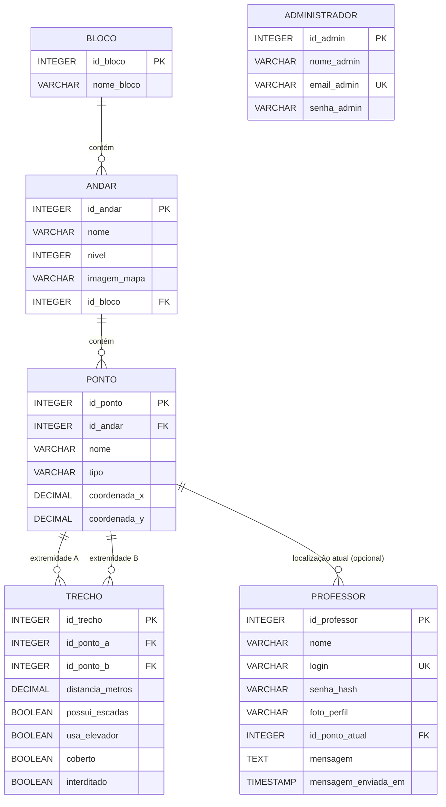

                                                        # CampusPath

### Sistema de Localização de Professores e Navegação no Campus

**Instituto Federal do Paraná – Campus Cascavel**
Curso Técnico Integrado de Informática
Linguagem de Programação II – 4.º Bimestre de 2026
Profª M.a. Roberta Vanessa Rojo Parcianello

**TCB – Trabalho de Conclusão do Bimestre**

| Item | Valor |
|---|---|
| Integrante | Marcelo Henrique Rocha Filho |
| RA | 20251CAS0020007 |
| Repositório | https://github.com/Mexpower2010/CampusPath_IFPR_TCA_2026 |
| Entrega documentada | Entrega 1 – Especificação e modelagem |
| Licença | MIT (ver `LICENSE`) |

Cascavel, PR — novembro de 2026

---

## Sumário

1. [Visão geral do sistema](#1-visão-geral-do-sistema)
2. [Requisitos funcionais (RF01–RF28)](#2-requisitos-funcionais-rf01rf28)
3. [Diagrama Entidade-Relacionamento (DER)](#3-diagrama-entidade-relacionamento-der)
4. [Relação de atributos das entidades](#4-relação-de-atributos-das-entidades)
5. [Estrutura do banco de dados](#5-estrutura-do-banco-de-dados)
6. [Configuração do projeto (pom.xml)](#6-configuração-do-projeto-pomxml)
7. [Estrutura de diretórios](#7-estrutura-de-diretórios)
8. [Como compilar e executar](#8-como-compilar-e-executar)
9. [Scripts SQL](#9-scripts-sql)
10. [Sincronização do estado entre computadores](#10-sincronização-do-estado-entre-computadores)
11. [Credenciais de teste](#11-credenciais-de-teste)
12. [Rastreabilidade: requisito → implementação](#12-rastreabilidade-requisito--implementação)
13. [Solução de problemas](#13-solução-de-problemas)
14. [Convenções de código](#14-convenções-de-código)
15. [Estado de verificação](#15-estado-de-verificação)

---

## 1. Visão geral do sistema

### 1.1 Finalidade

O CampusPath é um sistema de informação desenvolvido para o campus do Instituto Federal do Paraná –
Cascavel. Seu propósito é permitir que alunos encontrem professores que estejam atualmente no campus
e, quando desejado, calculem uma rota até a sala onde o professor se encontra. O sistema representa o
campus por meio de um grafo de pontos (salas, corredores e acessos) e de conexões entre eles, e aplica
o algoritmo de Dijkstra para encontrar o menor caminho entre dois pontos, respeitando as condições
físicas do percurso e as restrições escolhidas pelo usuário.

### 1.2 Usuários

O sistema possui três perfis de usuário.

| Perfil | Autenticação | Responsabilidade |
|---|---|---|
| **Aluno** | Não se autentica | Acessa o mapa e consulta a presença dos professores |
| **Professor** | Login e senha | Informa sua localização atual e publica uma mensagem destinada aos alunos |
| **Administrador** | E-mail e senha | Gerencia os cadastros, remove professores que deixam de utilizar o sistema e atualiza as condições dos trechos, como cobertura e interdição de percursos que utilizam escadas ou elevadores |

Todos os administradores possuem as mesmas permissões, sem divisão por tipo de administrador.

### 1.3 Funcionalidades

O sistema apresenta o mapa do campus como tela principal. As salas que possuem professores associados
exibem marcadores com as fotos de perfil dos professores presentes. Ao interagir com o marcador, o
aluno visualiza o nome do professor, sua mensagem e o horário em que a mensagem foi publicada ou
atualizada. A mensagem é escrita pelo professor e serve para explicar sua situação naquele momento —
por exemplo, se está disponível para atendimento ou se está em banca. Estar em uma sala, portanto, não
equivale automaticamente a estar disponível.

O aluno pode solicitar uma rota entre qualquer ponto de origem e uma sala de destino. O sistema aplica
o algoritmo de Dijkstra sobre os pontos e trechos cadastrados no banco de dados, destaca o percurso no
mapa e informa a distância total. O aluno pode escolher evitar escadas ou exigir que todo o percurso
seja coberto. O campus tem dois andares, e o mapa permite visualizar os blocos, os andares e as
ligações entre eles. Se as condições escolhidas pelo aluno impedirem qualquer caminho válido, o
sistema informa isso com uma mensagem clara.

O professor, após autenticar-se, informa a sala em que se encontra, publica ou atualiza sua mensagem
e, ao sair, remove sua presença. O horário associado à mensagem é registrado automaticamente pelo
sistema. O professor também pode atualizar sua foto de perfil. Cada professor tem no máximo uma
localização atual, e vários professores podem estar associados à mesma sala ao mesmo tempo, cada um
com sua própria mensagem individual.

O administrador realiza a manutenção dos cadastros de blocos, andares, pontos, trechos e professores.
Para acompanhar a rotatividade dos professores, pode cadastrar novos professores, alterar seus dados e
remover os que deixam de utilizar o sistema. Também atualiza as condições dos trechos, indicando se são
cobertos e se estão interditados. Quando um elevador ou uma escada está fora de funcionamento, o
administrador interdita os trechos correspondentes; quando o acesso é restabelecido, libera esses
trechos. O bloqueio de acesso a uma sala é representado pela interdição dos trechos que permitem
alcançá-la.

### 1.4 Regras de negócio

**Localização e mensagem**

- Um professor só pode informar uma sala como localização atual; ao informar outra sala, a localização
  anterior é substituída.
- Uma sala pode reunir vários professores ao mesmo tempo, mas cada um mantém sua mensagem
  independente.
- O horário da mensagem é registrado pelo sistema no momento da publicação ou atualização, e o
  professor não precisa informá-lo manualmente.
- A localização de um professor só pode ser associada a pontos do tipo `SALA`; pontos de passagem e
  acessos não são destinos válidos de presença.

**Cálculo de rota**

- A opção “evitar escadas” exclui do cálculo os trechos com escadas.
- O modo padrão permite escadas e não utiliza elevadores como caminho principal, pois o campus tem
  apenas dois andares e os elevadores são destinados prioritariamente a pessoas com deficiência.
- No modo "evitar escadas", elevadores em funcionamento podem ser utilizados.
- Trechos interditados nunca são incluídos no cálculo, independentemente do modo.
- Se não existir rota válida com as condições escolhidas, o sistema apresenta uma mensagem informativa
  e não desativa os filtros automaticamente.

**Integridade dos dados**

- Não é permitido cadastrar um trecho com as duas extremidades no mesmo ponto.
- A distância de um trecho deve ser maior que zero.
- O login do professor deve ser único no sistema.
- Não é permitido excluir um andar que ainda tenha pontos cadastrados.
- Não é permitido excluir um ponto que seja extremidade de trechos ou localização atual de algum
  professor.
- Cada andar pertence a exatamente um bloco, e cada ponto pertence a exatamente um andar.
- Blocos diferentes podem possuir andares no mesmo nível.
- Não é permitido excluir um bloco que ainda tenha andares cadastrados.
- Um trecho pode conectar pontos de andares ou blocos diferentes, desde que represente uma ligação
  física existente no campus.

**Operações administrativas**

- As operações administrativas exigem autenticação de administrador.
- Todos os administradores podem executar as mesmas funções administrativas.
- Ao remover um professor, o sistema exclui seu cadastro e as informações de localização e mensagem
  nele armazenadas, sem excluir a sala ou os trechos do mapa.
- Remover a presença, por outro lado, continua sendo uma ação do professor que não exclui seu perfil.
- A interdição de um trecho impede seu uso no cálculo de rotas, mas não exclui os pontos nem os
  professores associados às salas.

---

## 2. Requisitos funcionais (RF01–RF28)

Os requisitos funcionais a seguir estão numerados sequencialmente de RF01 a RF28 e agrupados por tema
para facilitar a leitura.

### 2.1 Mapa e Visualização

| RF | Requisito |
|---|---|
| **RF01** | O sistema deve exibir o mapa do campus como tela principal ao ser iniciado, sem exigir login do usuário. |
| **RF02** | O sistema deve permitir ao usuário selecionar o bloco e alternar entre os andares do campus no mapa. |
| **RF03** | O sistema deve exibir marcadores nas salas que possuem pelo menos um professor com localização atual informada, mostrando as fotos de perfil dos professores presentes. |
| **RF04** | Ao expandir um marcador de sala, o sistema deve exibir, para cada professor presente, seu nome, sua mensagem e o horário em que a mensagem foi publicada ou atualizada. |
| **RF05** | O sistema deve exibir mensagem informativa quando uma sala selecionada não possuir nenhum professor presente. |

### 2.2 Consulta de Professores

| RF | Requisito |
|---|---|
| **RF06** | O sistema deve permitir ao aluno consultar a lista de professores atualmente presentes no campus, com nome, sala e mensagem. |
| **RF07** | O sistema deve registrar automaticamente o horário de publicação ou atualização de cada mensagem do professor, sem exigir que o professor informe esse horário manualmente. |

### 2.3 Cálculo de Rota

| RF | Requisito |
|---|---|
| **RF08** | O sistema deve permitir ao aluno selecionar um ponto de origem e uma sala de destino para calcular uma rota. |
| **RF09** | O sistema deve calcular a rota de menor distância entre origem e destino utilizando o algoritmo de Dijkstra aplicado sobre os pontos e trechos cadastrados no banco de dados. |
| **RF10** | O sistema deve exibir a sequência de pontos do percurso e a distância total estimada em metros. |
| **RF11** | O sistema deve destacar visualmente o percurso calculado no mapa. |
| **RF12** | O sistema deve permitir ao aluno ativar a opção “evitar escadas”, excluindo completamente do cálculo os trechos que possuem escadas. |
| **RF13** | O sistema deve permitir ao aluno ativar a opção “somente coberto”, excluindo do cálculo os trechos descobertos. Essa opção pode ser combinada com “evitar escadas”. |
| **RF14** | Quando as condições escolhidas impedirem qualquer percurso válido entre origem e destino, o sistema deve exibir mensagem clara informando a ausência de rota e o motivo, sem desativar filtros automaticamente nem sugerir alternativas que violem as restrições escolhidas. |
| **RF15** | Quando a rota envolver dois andares ou blocos diferentes, o sistema deve representar a mudança de andar ou de bloco de forma compreensível ao aluno. |

### 2.4 Autenticação e Perfil do Professor

| RF | Requisito |
|---|---|
| **RF16** | O sistema deve permitir que o professor faça login informando seu login e senha. |
| **RF17** | O sistema deve exibir mensagem de erro clara em caso de credenciais inválidas. |
| **RF18** | O sistema deve permitir que o professor atualize sua foto de perfil. |
| **RF19** | O sistema deve permitir que o professor altere seu nome exibido. |

### 2.5 Localização e Mensagem do Professor

| RF | Requisito |
|---|---|
| **RF20** | O sistema deve permitir que o professor autenticado informe a sala em que se encontra, associando sua localização atual a um ponto do tipo SALA. |
| **RF21** | O sistema deve permitir que o professor autenticado publique ou atualize sua mensagem, registrando automaticamente o horário da atualização. |
| **RF22** | O sistema deve permitir que o professor autenticado altere sua localização para outra sala, substituindo a localização anterior. |
| **RF23** | O sistema deve permitir que o professor autenticado remova sua presença ao sair, limpando sua localização atual e sua mensagem sem excluir seu perfil. |

### 2.6 Administração (CRUD)

| RF | Requisito |
|---|---|
| **RF24** | O sistema deve oferecer ao administrador autenticado operações de cadastro, consulta, alteração e exclusão para blocos, andares, pontos do mapa, trechos e professores, respeitando as restrições de integridade referencial definidas no modelo de dados. |
| **RF25** | O sistema deve permitir que o administrador faça login informando seu e-mail e senha, com mensagem de erro clara em caso de credenciais inválidas. |
| **RF26** | O sistema deve conceder as mesmas permissões a todos os administradores autenticados, sem distinção por tipo de administrador. |
| **RF27** | O sistema deve permitir ao administrador remover professores que deixam de utilizar o sistema, excluindo os respectivos cadastros e suas informações de presença e mensagem, sem excluir as salas ou os trechos do mapa. |
| **RF28** | O sistema deve permitir ao administrador atualizar as condições dos trechos, alterando sua cobertura e sua interdição ou liberação, inclusive nos percursos que utilizam escadas e elevadores. Trechos interditados não devem ser utilizados no cálculo de rotas. |

---

## 3. Diagrama Entidade-Relacionamento (DER)

O modelo de dados do CampusPath é composto por seis entidades: **BLOCO, ANDAR, PONTO, TRECHO,
PROFESSOR e ADMINISTRADOR**. BLOCO organiza os andares do campus, e ADMINISTRADOR representa os
usuários responsáveis pela manutenção dos cadastros, pela remoção de professores e pela atualização
das condições dos trechos.

As duas ligações entre PONTO e TRECHO representam os dois papéis das extremidades de um mesmo trecho.
As letras **A** e **B** não indicam origem e destino fixos: todo trecho é **bidirecional** no cálculo
de rotas.



*Figura 1 – Diagrama Entidade-Relacionamento do CampusPath.*

---

## 4. Relação de atributos das entidades

As tabelas a seguir listam os atributos de cada entidade. Na coluna **Chave**, `PK` identifica a chave
primária, `FK` identifica a chave estrangeira (com a entidade referenciada) e `UNIQUE` indica valor
que não pode se repetir.

### Tabela 1 – Relacionamentos e cardinalidades

| Relacionamento | Cardinalidade | Descrição |
|---|---|---|
| BLOCO → ANDAR | 1:N | Um bloco contém vários andares; cada andar pertence a exatamente um bloco. |
| ANDAR → PONTO | 1:N | Um andar contém vários pontos; cada ponto pertence a exatamente um andar. |
| PONTO → TRECHO (extremidade A) | 1:N | Um ponto pode ser a extremidade A de vários trechos; cada trecho tem uma extremidade A. |
| PONTO → TRECHO (extremidade B) | 1:N | Um ponto pode ser a extremidade B de vários trechos; cada trecho tem uma extremidade B. |
| PONTO (SALA) → PROFESSOR | 1:N | Uma sala pode ser a localização atual de vários professores; cada professor tem no máximo uma sala atual (FK opcional). |

### Tabela 2 – Entidade: BLOCO

| Atributo | Tipo | Chave | Descrição |
|---|---|---|---|
| `id_bloco` | INTEGER | PK | Identificador único do bloco, gerado automaticamente. |
| `nome_bloco` | VARCHAR(45) | — | Nome do bloco, utilizado para identificá-lo na seleção dos mapas. |

### Tabela 3 – Entidade: ANDAR

| Atributo | Tipo | Chave | Descrição |
|---|---|---|---|
| `id_andar` | INTEGER | PK | Identificador único do andar, gerado automaticamente. |
| `nome` | VARCHAR(50) | — | Nome descritivo do andar (ex.: “Térreo”, “Primeiro Andar”). |
| `nivel` | INTEGER | — | Número do nível (0 para térreo, 1 para primeiro andar). |
| `imagem_mapa` | VARCHAR(255) | — | Caminho ou referência para a imagem do mapa deste andar. |
| `id_bloco` | INTEGER | FK → BLOCO | Bloco ao qual o andar pertence. Referência obrigatória. |

### Tabela 4 – Entidade: PONTO

| Atributo | Tipo | Chave | Descrição |
|---|---|---|---|
| `id_ponto` | INTEGER | PK | Identificador único do ponto, gerado automaticamente. |
| `id_andar` | INTEGER | FK → ANDAR | Andar ao qual o ponto pertence. |
| `nome` | VARCHAR(100) | — | Nome do ponto (ex.: “Sala 201”, “Corredor A”). |
| `tipo` | VARCHAR(20) | — | Categoria do ponto: SALA, PASSAGEM ou ACESSO. |
| `coordenada_x` | DECIMAL(8,1) | — | Posição horizontal no mapa do andar. |
| `coordenada_y` | DECIMAL(8,1) | — | Posição vertical no mapa do andar. |

### Tabela 5 – Entidade: TRECHO

| Atributo | Tipo | Chave | Descrição |
|---|---|---|---|
| `id_trecho` | INTEGER | PK | Identificador único do trecho, gerado automaticamente. |
| `id_ponto_a` | INTEGER | FK → PONTO | Primeira extremidade do trecho (bidirecional). |
| `id_ponto_b` | INTEGER | FK → PONTO | Segunda extremidade do trecho (bidirecional). |
| `distancia_metros` | DECIMAL(8,1) | — | Distância em metros entre os dois pontos; deve ser maior que zero. |
| `possui_escadas` | BOOLEAN | — | Indica se o trecho passa por escadas. |
| `usa_elevador` | BOOLEAN | — | Indica se o trecho utiliza o elevador. |
| `coberto` | BOOLEAN | — | Indica se o trecho é coberto (protegido de chuva). |
| `interditado` | BOOLEAN | — | Indica se o trecho está interditado e não pode ser usado. |

### Tabela 6 – Entidade: PROFESSOR

| Atributo | Tipo | Chave | Descrição |
|---|---|---|---|
| `id_professor` | INTEGER | PK | Identificador único do professor, gerado automaticamente. |
| `nome` | VARCHAR(120) | — | Nome completo do professor, exibido no mapa e no perfil. |
| `login` | VARCHAR(60) | UNIQUE | Identificador de acesso único do professor. |
| `senha_hash` | VARCHAR(255) | — | Hash da senha do professor; a senha não é armazenada em texto puro. |
| `foto_perfil` | VARCHAR(255) | — | Caminho ou referência para a imagem de perfil do professor. |
| `id_ponto_atual` | INTEGER | FK → PONTO (opcional) | Sala atual do professor; nulo quando não há localização informada. Restrito a pontos do tipo SALA. |
| `mensagem` | TEXT | — | Mensagem atual do professor para os alunos. |
| `mensagem_enviada_em` | TIMESTAMP | — | Horário registrado automaticamente ao publicar ou atualizar a mensagem. |

### Tabela 7 – Entidade: ADMINISTRADOR

| Atributo | Tipo | Chave | Descrição |
|---|---|---|---|
| `id_admin` | INTEGER | PK | Identificador único do administrador, gerado automaticamente. |
| `nome_admin` | VARCHAR(45) | — | Nome do administrador, utilizado para identificá-lo no sistema. |
| `email_admin` | VARCHAR(45) | UNIQUE | E-mail utilizado para autenticação. Não pode se repetir entre os administradores. |
| `senha_admin` | VARCHAR(255) | — | Hash da senha do administrador; a senha não é armazenada em texto puro. |

---

## 5. Estrutura do banco de dados

O schema implementa exatamente as seis entidades e os atributos das Tabelas 2 a 7. O script completo
está em `campus_path/src/main/resources/db/schema.sql`.

### 5.1 DDL

```sql
create database if not exists campuspath;
use campuspath;

create table if not exists bloco(
   id_bloco int not null auto_increment,
   nome_bloco varchar(45) not null,
   primary key(id_bloco)
);

create table if not exists andar(
   id_andar int not null auto_increment,
   nome varchar(50) not null,
   nivel int not null,
   imagem_mapa varchar(255),
   id_bloco int not null,
   primary key(id_andar),
   constraint FK_Andar_Bloco foreign key(id_bloco)
      references bloco(id_bloco)
);

create table if not exists ponto(
   id_ponto int not null auto_increment,
   id_andar int not null,
   nome varchar(100) not null,
   tipo varchar(20) not null,
   coordenada_x decimal(8,1),
   coordenada_y decimal(8,1),
   primary key(id_ponto),
   constraint FK_Ponto_Andar foreign key(id_andar)
      references andar(id_andar),
   constraint CK_Ponto_Tipo check(tipo in ('SALA','PASSAGEM','ACESSO'))
);

create table if not exists trecho(
   id_trecho int not null auto_increment,
   id_ponto_a int not null,
   id_ponto_b int not null,
   distancia_metros decimal(8,1) not null,
   possui_escadas boolean not null default false,
   usa_elevador boolean not null default false,
   coberto boolean not null default false,
   interditado boolean not null default false,
   primary key(id_trecho),
   constraint FK_Trecho_PontoA foreign key(id_ponto_a)
      references ponto(id_ponto),
   constraint FK_Trecho_PontoB foreign key(id_ponto_b)
      references ponto(id_ponto),
   constraint CK_Trecho_Extremidades check(id_ponto_a <> id_ponto_b),
   constraint CK_Trecho_Distancia check(distancia_metros > 0)
);

create table if not exists professor(
   id_professor int not null auto_increment,
   nome varchar(120) not null,
   login varchar(60) not null,
   senha_hash varchar(255) not null,
   foto_perfil varchar(255),
   id_ponto_atual int,
   mensagem text,
   mensagem_enviada_em timestamp,
   primary key(id_professor),
   constraint UN_Professor_Login unique(login),
   constraint FK_Professor_Ponto foreign key(id_ponto_atual)
      references ponto(id_ponto)
);

create table if not exists administrador(
   id_admin int not null auto_increment,
   nome_admin varchar(45) not null,
   email_admin varchar(45) not null,
   senha_admin varchar(255) not null,
   primary key(id_admin),
   constraint UN_Admin_Email unique(email_admin)
);
```

### 5.2 Tabela de controle da aplicação

Além das seis entidades, existe uma tabela de apoio que **não faz parte do DER**: `controle_sync`
guarda o timestamp do último snapshot importado (ver seção 10).

```sql
create table if not exists controle_sync(
   id_controle int not null,
   snapshot_aplicado_em varchar(19),
   primary key(id_controle)
);
```

### 5.3 Triggers

A regra "a localização do professor só pode ser um ponto do tipo SALA" não pode ser expressa em um
`CHECK`, porque exige consultar outra tabela. Por isso é garantida por dois triggers:

```sql
DELIMITER $$

drop trigger if exists Tgr_Professor_PontoSala_Insert$$
drop trigger if exists Tgr_Professor_PontoSala_Update$$

create trigger Tgr_Professor_PontoSala_Insert before insert
on professor
for each row
begin
   if new.id_ponto_atual is not null then
      if (select tipo from ponto where id_ponto = new.id_ponto_atual) <> 'SALA' then
         signal sqlstate '45000'
            set message_text = 'A localizacao do professor deve ser um ponto do tipo SALA.';
      end if;
   end if;
end$$

create trigger Tgr_Professor_PontoSala_Update before update
on professor
for each row
begin
   if new.id_ponto_atual is not null then
      if (select tipo from ponto where id_ponto = new.id_ponto_atual) <> 'SALA' then
         signal sqlstate '45000'
            set message_text = 'A localizacao do professor deve ser um ponto do tipo SALA.';
      end if;
   end if;
end$$

DELIMITER ;
```

### 5.4 Onde cada regra de negócio é garantida

| Regra (seção 1.4) | Garantida por | Objeto |
|---|---|---|
| Trecho não pode ter as duas extremidades no mesmo ponto | `CHECK` | `CK_Trecho_Extremidades` |
| Distância do trecho maior que zero | `CHECK` | `CK_Trecho_Distancia` |
| Tipo de ponto restrito a SALA, PASSAGEM ou ACESSO | `CHECK` | `CK_Ponto_Tipo` |
| Login do professor único | `UNIQUE` | `UN_Professor_Login` |
| E-mail do administrador único | `UNIQUE` | `UN_Admin_Email` |
| Localização do professor só em ponto SALA | Trigger | `Tgr_Professor_PontoSala_Insert/Update` |
| Não excluir bloco com andares | FK | `FK_Andar_Bloco` |
| Não excluir andar com pontos | FK | `FK_Ponto_Andar` |
| Não excluir ponto usado em trecho | FK | `FK_Trecho_PontoA`, `FK_Trecho_PontoB` |
| Não excluir ponto que é localização de professor | FK | `FK_Professor_Ponto` |
| Trecho interditado nunca entra na rota | Aplicação | `RotaService.filtrar()` |
| "Evitar escadas" libera elevador | Aplicação | `RotaService.filtrar()` |
| Sem rota: mensagem informativa, filtros mantidos | Aplicação | `RotaService.motivoSemRota()` |
| Senha nunca em texto puro | Aplicação | `Senha.hash()` (SHA-256) |
| Horário da mensagem registrado pelo sistema | Aplicação | `ProfessorDAO.publicarMensagem()` |

As FKs usam o comportamento padrão do InnoDB, `ON DELETE RESTRICT`: o banco recusa apagar um registro
que ainda é referenciado, o que realiza as regras de integridade sem código adicional.

---

## 6. Configuração do projeto (pom.xml)

```xml
<?xml version="1.0" encoding="UTF-8"?>
<project xmlns="http://maven.apache.org/POM/4.0.0"
         xmlns:xsi="http://www.w3.org/2001/XMLSchema-instance"
         xsi:schemaLocation="http://maven.apache.org/POM/4.0.0 http://maven.apache.org/xsd/maven-4.0.0.xsd">
    <modelVersion>4.0.0</modelVersion>

    <groupId>ifpr.edu</groupId>
    <artifactId>campus_path</artifactId>
    <version>1.0-SNAPSHOT</version>

    <properties>
        <maven.compiler.source>21</maven.compiler.source>
        <maven.compiler.target>21</maven.compiler.target>
    </properties>
    <dependencies>
        <dependency>
            <groupId>mysql</groupId>
            <artifactId>mysql-connector-java</artifactId>
            <version>8.0.33</version>
        </dependency>
    </dependencies>
</project>
```

| Item | Valor |
|---|---|
| `groupId` | `ifpr.edu` |
| `artifactId` | `campus_path` |
| `version` | `1.0-SNAPSHOT` |
| Java | 21 (`maven.compiler.source` e `target`) |
| Driver JDBC | `mysql:mysql-connector-java:8.0.33` |
| Empacotamento | padrão (`jar`) |

O projeto tem **uma única dependência externa**: o driver JDBC do MySQL. Não há ORM, framework de
injeção, biblioteca de terceiros para o algoritmo de rota, nem suíte de testes declarada. O Dijkstra é
implementado à mão com `java.util.PriorityQueue`.

Como o POM não configura `maven-jar-plugin` com `Main-Class` nem `maven-shade-plugin`, o `mvn package`
produz um JAR comum, sem o driver embutido. A execução é feita com `-cp` explícito (seção 8).

---

## 7. Estrutura de diretórios

```
CampusPath_IFPR_TCA_2026/
├── README.md                      este arquivo
├── LICENSE                        MIT
├── .gitignore                     ignora target/, db.properties e arquivos de IDE
├── web/                           site estático servido pelo próprio Java (Modo A)
│   ├── index.html                 mapa, salas e cálculo de rota
│   ├── professor.html             login e área do professor
│   ├── admin.html                 login e CRUD administrativo
│   ├── .nojekyll                  evita o processamento do Jekyll no GitHub Pages
│   ├── css/
│   │   └── estilo.css             tema escuro, grade, mapa, tabelas
│   └── js/
│       ├── api.js                 cliente fetch com token Bearer
│       ├── mapa.js                desenho do mapa em SVG
│       ├── index.js               lógica da página de mapa e rota
│       ├── professor.js           lógica da área do professor
│       └── admin.js               lógica do CRUD administrativo
└── campus_path/                   projeto Maven
    ├── pom.xml
    ├── dados/
    │   └── snapshot.sql           estado do banco versionado no Git (seção 10)
    ├── src/main/java/ifpr/edu/
    │   ├── Main.java              ponto de entrada (--web ou --console)
    │   ├── api/
    │   │   ├── ServidorHttp.java  com.sun.net.httpserver: API + arquivos estáticos
    │   │   ├── Api.java           tabela de rotas HTTP
    │   │   ├── Roteador.java      casamento de método + padrão com {id}
    │   │   ├── Requisicao.java    método, caminho, query, corpo e token
    │   │   ├── Resposta.java      status, corpo e content-type
    │   │   ├── Json.java          escrita e leitura de JSON sem biblioteca externa
    │   │   ├── JsonModelo.java    conversão das entidades para JSON
    │   │   ├── ApiMapa.java       handlers de blocos, andares, pontos e trechos
    │   │   ├── ApiPessoas.java    handlers de autenticação, professores e administradores
    │   │   ├── ApiRota.java       handlers de mapa, rota e snapshot
    │   │   ├── SessaoService.java tokens em memória com validade de 2 horas
    │   │   ├── Autorizacao.java   exigirSessao, exigirAdmin, exigirProfessor
    │   │   ├── Contexto.java      DAOs, serviços e sessões compartilhados
    │   │   └── ErroHttp.java      exceção com status HTTP
    │   ├── db/
    │   │   ├── Conexao.java       lê db.properties/env e devolve Connection
    │   │   └── PersistenciaException.java
    │   ├── model/
    │   │   ├── Bloco.java
    │   │   ├── Andar.java
    │   │   ├── Ponto.java
    │   │   ├── TipoPonto.java     enum SALA, PASSAGEM, ACESSO
    │   │   ├── Trecho.java
    │   │   ├── Professor.java
    │   │   └── Administrador.java
    │   ├── dao/
    │   │   ├── BlocoDAO.java
    │   │   ├── AndarDAO.java
    │   │   ├── PontoDAO.java
    │   │   ├── TrechoDAO.java
    │   │   ├── ProfessorDAO.java
    │   │   ├── AdministradorDAO.java
    │   │   └── SnapshotService.java
    │   ├── service/
    │   │   ├── RotaService.java   Dijkstra + filtros
    │   │   ├── Rota.java          resultado imutável
    │   │   └── AutenticacaoService.java
    │   ├── ui/
    │   │   ├── MenuPrincipal.java
    │   │   ├── MenuAluno.java
    │   │   ├── MenuProfessor.java
    │   │   ├── MenuAdmin.java
    │   │   └── Entrada.java
    │   └── util/
    │       └── Senha.java         SHA-256
    └── src/main/resources/
        ├── db.properties.example  modelo de configuração (versionado)
        └── db/
            ├── schema.sql         DDL: 6 tabelas + controle_sync + 2 triggers
            ├── dados_iniciais.sql dados de teste
            ├── procedures.sql     4 procedures de apoio
            ├── consultas.sql      consultas e joins de apoio
            └── usuario.sql        usuário de aplicação com permissão mínima
```

Total: **40 arquivos Java** (26 do núcleo + 14 do pacote `api`). Não existe `src/test`.

### 7.1 Camadas

```
api       ServidorHttp, roteador, handlers e JSON (Modo A)
ui        menus de console e leitura de teclado (Modo --console)
service   RotaService (Dijkstra), Rota, AutenticacaoService
dao       acesso a dados com PreparedStatement
model     objetos de domínio (POJOs)
db        Conexao e PersistenciaException
util      Senha (SHA-256)
```

Regras de dependência: `api` e `ui` nunca contêm SQL; `dao` é a única camada que fala SQL; `model` não
depende de ninguém; toda falha de banco chega às bordas como `PersistenciaException` com mensagem em
português. O pacote `api` reutiliza exatamente os mesmos DAOs e serviços do console — não há segunda
implementação de regra de negócio.

---

## 8. Como compilar e executar

O modo padrão é o **Modo A**: um único processo Java serve a API JSON e o site estático em
`http://localhost:8080`, na mesma origem. O modo console continua disponível com `--console`.

### 8.1 Preparar o banco (uma vez por computador)

```bash
mysql -u root -p < campus_path/src/main/resources/db/schema.sql
mysql -u root -p < campus_path/src/main/resources/db/dados_iniciais.sql
mysql -u root -p < campus_path/src/main/resources/db/usuario.sql
```

Não passe o nome do banco no comando: o `schema.sql` já executa `create database if not exists` e
`use campuspath`.

O `usuario.sql` cria `campuspath@localhost` com permissão apenas de `SELECT`, `INSERT`, `UPDATE` e
`DELETE`. Antes de executá-lo, troque `TROCAR_ESTA_SENHA` por uma senha sua — ela será usada no
`db.properties`. Se preferir usar `root` no desenvolvimento, pule este passo e ajuste o
`db.properties` para `db.user=root` com a senha do root.

### 8.2 Configurar a conexão

Copie `campus_path/src/main/resources/db.properties.example` para
`campus_path/src/main/resources/db.properties` e preencha usuário e senha:

```properties
db.url=jdbc:mysql://localhost:3306/campuspath?useSSL=false&allowPublicKeyRetrieval=true&serverTimezone=America/Sao_Paulo&characterEncoding=UTF-8
db.user=campuspath
db.password=senha_definida_em_usuario.sql
```

A senha precisa ser exatamente a mesma definida no `usuario.sql`; se ficar vazia, o MySQL recusa o
login do usuário `campuspath`.

Alternativamente, use as variáveis de ambiente `CAMPUSPATH_DB_URL`, `CAMPUSPATH_DB_USER` e
`CAMPUSPATH_DB_PASSWORD`, que têm precedência sobre o arquivo. O `db.properties` está no `.gitignore`
e não deve ser commitado.

| Parâmetro da URL | Motivo |
|---|---|
| `useSSL=false` | Conexão local, sem certificado |
| `allowPublicKeyRetrieval=true` | Sem isso o MySQL 8 recusa login com `caching_sha2_password` |
| `serverTimezone=America/Sao_Paulo` | Evita erro de fuso em `mensagem_enviada_em` (TIMESTAMP) |
| `characterEncoding=UTF-8` | Preserva acentos nas mensagens dos professores |

### 8.3 Com Maven

```bash
cd campus_path
mvn clean package
java -cp "target/classes:$HOME/.m2/repository/mysql/mysql-connector-java/8.0.33/mysql-connector-java-8.0.33.jar" ifpr.edu.Main --web 8080
```

No Windows, troque `:` por `;` no classpath.

### 8.4 Sem Maven (apenas JDK + driver)

```bash
cd campus_path
CP="$HOME/.m2/repository/mysql/mysql-connector-java/8.0.33/mysql-connector-java-8.0.33.jar"
javac -encoding UTF-8 -d target/classes -cp "$CP" $(find src/main/java -name "*.java")
java -cp "target/classes:$CP" ifpr.edu.Main --web 8080
```

Windows (PowerShell):

```powershell
$CP = "$env:USERPROFILE\.m2\repository\mysql\mysql-connector-java\8.0.33\mysql-connector-java-8.0.33.jar"
javac -encoding UTF-8 -d target/classes -cp $CP (Get-ChildItem -Recurse src/main/java -Filter *.java).FullName
java -cp "target/classes;$CP" ifpr.edu.Main --web 8080
```

O driver também pode ser baixado direto do repositório oficial e passado em `-cp`; o caminho do `.m2`
acima é apenas o que o Maven usa por padrão.

### 8.5 Modos de execução e fluxo de inicialização

| Comando | O que faz |
|---|---|
| `java ifpr.edu.Main --web 8080` | Sobe o servidor HTTP na porta indicada (padrão 8080) e serve a API e o site |
| `java ifpr.edu.Main --console` | Abre os menus de console |
| `java ifpr.edu.Main` | Assume `--web` na porta 8080 |

Nos dois modos, `Main` chama `SnapshotService.sincronizar()` antes de abrir a interface: se o banco
estiver vazio e existir `dados/snapshot.sql`, o estado versionado é importado. No modo console, a opção
`0` exporta o estado de volta para `dados/snapshot.sql`; no modo web, o mesmo é feito pelo botão
**Exportar snapshot** da página de administração (`POST /api/snapshot`).

O servidor procura a pasta do site em `web` e `../web`, nesta ordem, a partir do diretório de
execução. Rodando de `campus_path/`, ele encontra `../web`.

### 8.6 Mapa dos menus (modo console)

```
Menu principal
├── 1 Área do aluno
│   ├── 1 Ver mapa do campus        → escolhe bloco, andar, opcionalmente abre uma sala
│   ├── 2 Professores presentes     → nome, sala, mensagem, horário
│   └── 3 Calcular rota             → origem, destino, evitar escadas, somente coberto
├── 2 Acesso do professor           → login + senha
│   ├── 1 Ver meu perfil
│   ├── 2 Atualizar foto de perfil
│   ├── 3 Alterar nome exibido
│   ├── 4 Informar ou alterar minha sala
│   ├── 5 Publicar ou atualizar mensagem
│   └── 6 Remover minha presença
├── 3 Acesso do administrador       → e-mail + senha
│   ├── 1 Blocos            (listar, cadastrar, alterar, excluir)
│   ├── 2 Andares           (listar, cadastrar, alterar, excluir)
│   ├── 3 Pontos do mapa    (listar, cadastrar, alterar, excluir)
│   ├── 4 Trechos           (listar, cadastrar, alterar, condições, excluir)
│   ├── 5 Professores       (listar, cadastrar, alterar, excluir)
│   └── 6 Administradores   (listar, cadastrar, alterar, excluir)
└── 0 Sair e salvar o estado no repositório
```

### 8.7 API HTTP (Modo A)

Todas as rotas ficam na mesma origem do site (`http://localhost:8080`), então não há CORS nem
configuração de proxy. O corpo é JSON; a autenticação usa `Authorization: Bearer <token>`.

| Método | Rota | Acesso | Função |
|---|---|---|---|
| GET | `/api/saude` | livre | Verificação de disponibilidade |
| POST | `/api/auth/professor` | livre | Login com `login` e `senha`; devolve token |
| POST | `/api/auth/admin` | livre | Login com `email` e `senha`; devolve token |
| GET | `/api/auth/sessao` | sessão | Tipo, id, nome e validade da sessão |
| POST | `/api/auth/sair` | sessão | Encerra a sessão |
| GET | `/api/mapa` | livre | Blocos, andares, pontos, trechos e professores presentes |
| GET | `/api/rotas?origem&destino&evitarEscadas&somenteCoberto` | livre | Rota calculada com passos e ids do caminho |
| GET/POST | `/api/blocos` | livre / admin | Listar e cadastrar blocos |
| PUT/DELETE | `/api/blocos/{id}` | admin | Alterar e excluir blocos |
| GET/POST | `/api/andares` | livre / admin | Listar (filtro `?bloco=`) e cadastrar andares |
| PUT/DELETE | `/api/andares/{id}` | admin | Alterar e excluir andares |
| GET/POST | `/api/pontos` | livre / admin | Listar (filtros `?andar=` e `?tipo=SALA`) e cadastrar pontos |
| PUT/DELETE | `/api/pontos/{id}` | admin | Alterar e excluir pontos |
| GET/POST | `/api/trechos` | livre / admin | Listar e cadastrar trechos |
| PUT/DELETE | `/api/trechos/{id}` | admin | Alterar e excluir trechos |
| PATCH | `/api/trechos/{id}/condicoes` | admin | Alterar apenas `coberto` e `interditado` |
| GET/POST | `/api/professores` | livre / admin | Listar (filtros `?presentes` e `?sala=`) e cadastrar professores |
| PUT/DELETE | `/api/professores/{id}` | admin | Alterar e excluir professores |
| PUT | `/api/professores/{id}/nome` | próprio professor | Alterar nome exibido |
| PUT | `/api/professores/{id}/foto` | próprio professor | Alterar foto de perfil |
| PUT | `/api/professores/{id}/localizacao` | próprio professor | Informar a sala atual (`idPonto` do tipo SALA) |
| PUT | `/api/professores/{id}/mensagem` | próprio professor | Publicar mensagem com horário do banco |
| DELETE | `/api/professores/{id}/presenca` | próprio professor | Remover a presença mantendo o cadastro |
| GET/POST | `/api/administradores` | admin | Listar e cadastrar administradores |
| PUT/DELETE | `/api/administradores/{id}` | admin | Alterar e excluir administradores |
| POST | `/api/snapshot` | admin | Exportar o estado para `dados/snapshot.sql` |

Códigos de erro: `400` para dado inválido ou regra de negócio, `401` para token ausente ou expirado,
`403` para sessão de outro tipo ou de outro professor, `404` para registro inexistente e `500` para
falha inesperada. O corpo do erro é sempre `{"erro": "mensagem em português"}`.

As sessões são mantidas em memória (`SessaoService`), com validade de 2 horas; reiniciar o servidor
invalida os tokens emitidos.

### 8.8 Site estático (`web/`)

| Página | Conteúdo |
|---|---|
| `index.html` | Mapa em SVG do andar, lista de salas, professores presentes, detalhe da sala e cálculo de rota |
| `professor.html` | Login, sala atual, remoção de presença, mensagem, nome e foto |
| `admin.html` | Login e CRUD de blocos, andares, pontos, trechos, professores e administradores, além do snapshot |

O site não tem build: são HTML, CSS e JavaScript puros, sem dependências externas. O mesmo conteúdo
pode ser publicado no GitHub Pages, mas nesse caso as chamadas `/api/*` não existem — a versão com
banco exige o servidor Java rodando. Por isso o modo padrão do projeto é o Modo A, com site e API na
mesma origem.

---

## 9. Scripts SQL

Executar nesta ordem, conectado como `root`:

| Ordem | Arquivo | O que faz |
|---|---|---|
| 1 | `db/schema.sql` | Cria o banco `campuspath`, as 6 tabelas, `controle_sync` e os 2 triggers |
| 2 | `db/dados_iniciais.sql` | Insere 2 blocos, 3 andares, 15 pontos, 15 trechos, 1 administrador e 3 professores |
| 3 | `db/procedures.sql` | Cria 4 procedures de apoio (opcional) |
| 4 | `db/consultas.sql` | Apenas consultas de exemplo, não altera dados (opcional) |
| 5 | `db/usuario.sql` | Cria o usuário `campuspath@localhost` com permissão mínima (troque a senha placeholder antes) |

### 9.1 Procedures

| Procedure | Assinatura | Uso |
|---|---|---|
| `Listar_Professores_Presentes()` | sem parâmetros | Lista nome, sala, mensagem e horário |
| `Contar_Pontos_Andar(in ida, out total)` | IN/OUT | Conta pontos de um andar |
| `Remover_Presenca(in idp)` | IN | Anula sala, mensagem e horário |
| `Atualizar_Localizacao(in idp, in idpt)` | IN | Troca a sala do professor |

Todas usam `drop procedure if exists` antes do `create`, então podem ser reexecutadas.

### 9.2 Consultas de apoio

`consultas.sql` reproduz os joins vistos em aula: produto cartesiano equivalente a `inner join`,
`left join` de salas com professores, `right join` de professores com salas, `union` como
`full outer join`, e as consultas de trechos liberados, sem escada e cobertos.

---

## 10. Sincronização do estado entre computadores

O banco MySQL **não** é versionado. O que vai para o Git é `campus_path/dados/snapshot.sql`, um
arquivo texto com o estado completo das seis tabelas.

### 10.1 Como funciona

1. Ao sair pela opção `0` do console ou ao usar **Exportar snapshot** na página de administração,
   `SnapshotService.exportar()` grava:
   - cabeçalho com `-- Gerado em yyyy-MM-dd HH:mm:ss`;
   - `delete from` das seis tabelas, na ordem que respeita as FKs;
   - `insert into` de blocos, andares, pontos, trechos, administradores e professores;
   - `update controle_sync set snapshot_aplicado_em = '<timestamp>'`.
2. Antes de gravar, `verificado()` compara `count(*)` de cada tabela com o número de linhas geradas.
   Se divergir, lança exceção em vez de gravar um snapshot incompleto.
3. Ao iniciar, `SnapshotService.sincronizar()` lê o `-- Gerado em` do arquivo e compara com
   `controle_sync.snapshot_aplicado_em`. Se forem iguais, nada acontece. Se forem diferentes, o
   arquivo é aplicado.
4. A aplicação é feita em **transação** (`setAutoCommit(false)` + `commit`/`rollback`): ou todas as
   linhas entram, ou nenhuma.
5. Se o snapshot referenciar pontos inexistentes (erro 1452), a mensagem orienta executar o
   `schema.sql` antes.

### 10.2 Uso em outro computador

```bash
# 1. criar a estrutura
mysql -u root -p < campus_path/src/main/resources/db/schema.sql
# 2. clonar o repositório (o snapshot vem junto)
git clone https://github.com/Mexpower2010/CampusPath_IFPR_TCA_2026
# 3. configurar db.properties e executar
java -cp "target/classes:$CP" ifpr.edu.Main --web 8080
# saída esperada: "Estado sincronizado a partir de dados/snapshot.sql"
```

### 10.3 Limitações

- A sincronização é por **commit**, não em tempo real. Se duas máquinas alterarem o banco sem
  commitar entre si, o último commit vence.
- O snapshot carrega os hashes de senha. Como o repositório é público, as credenciais de teste são
  conhecidas — aceitável para trabalho acadêmico, não para uso real.
- O arquivo é gravado no diretório de trabalho atual (`dados/snapshot.sql`). Execute a aplicação a
  partir da pasta `campus_path` para que o caminho coincida com o versionado.

---

## 11. Credenciais de teste

| Perfil | Acesso | Senha |
|---|---|---|
| Administrador | `admin@campuspath.ifpr.edu.br` | `admin123` |
| Professora | `roberta.parcianello` | `123456` |
| Professor | `fabio.moreira` | `123456` |
| Professora | `ana.souza` | `123456` |

As senhas são gravadas como SHA-256 hexadecimal em `senha_hash` (professor) e `senha_admin`
(administrador), conforme a Tabela 6 e a Tabela 7.

> SHA-256 sem salt atende ao escopo da disciplina, mas não é adequado para produção — o correto seria
> `bcrypt`, `scrypt` ou `PBKDF2` com salt por usuário.

---

## 12. Rastreabilidade: requisito → implementação

| RF | Implementação |
|---|---|
| RF01 | `MenuPrincipal.abrir()` → opção 1 → `MenuAluno.verMapa()` |
| RF02 | `MenuAluno.verMapa()` com `BlocoDAO.listar()` e `AndarDAO.listarPorBloco()` |
| RF03 | `MenuAluno.exibirAndar()` marca `[*]` quando `ProfessorDAO.listarPorSala()` não está vazio |
| RF04 | `MenuAluno.expandirSala()` |
| RF05 | `MenuAluno.expandirSala()` → "nenhum professor presente nesta sala no momento" |
| RF06 | `MenuAluno.listarPresentes()` → `ProfessorDAO.listarPresentes()` |
| RF07 | `ProfessorDAO.publicarMensagem()` grava `LocalDateTime.now()` |
| RF08 | `MenuAluno.calcularRota()` |
| RF09 | `RotaService.calcular()` — Dijkstra com `PriorityQueue` |
| RF10 | `Rota.getPassos()` e `Rota.getDistanciaTotal()` |
| RF11 | `MenuAluno.exibirAndar(andar, rota)` marca `<== rota` |
| RF12 | `RotaService.filtrar()` descarta `possui_escadas = true` |
| RF13 | `RotaService.filtrar()` descarta `coberto = false`, combinável com RF12 |
| RF14 | `RotaService.motivoSemRota()` |
| RF15 | `RotaService.calcular()` insere "Troca de andar" e "Troca de bloco" |
| RF16 | `MenuProfessor.abrir()` → `AutenticacaoService.autenticarProfessor()` |
| RF17 | `AutenticacaoService` → "Login ou senha invalidos." |
| RF18 | `MenuProfessor.atualizarFoto()` → `ProfessorDAO.atualizarFoto()` |
| RF19 | `MenuProfessor.atualizarNome()` → `ProfessorDAO.atualizarNome()` |
| RF20 | `MenuProfessor.atualizarSala()` valida `Ponto.isSala()` |
| RF21 | `MenuProfessor.publicarMensagem()` → `ProfessorDAO.publicarMensagem()` |
| RF22 | `ProfessorDAO.atualizarLocalizacao()` |
| RF23 | `ProfessorDAO.removerPresenca()` |
| RF24 | `MenuAdmin.menuBlocos/menuAndares/menuPontos/menuTrechos/menuProfessores` |
| RF25 | `MenuAdmin.abrir()` → `AutenticacaoService.autenticarAdministrador()` |
| RF26 | Não há coluna de perfil ou nível; qualquer linha em `administrador` tem acesso total |
| RF27 | `ProfessorDAO.excluir()` remove só a linha de `professor` |
| RF28 | `MenuAdmin.menuTrechos()` opção 4 → `TrechoDAO.atualizarCondicoes()` |

No Modo A, cada RF tem o equivalente HTTP usando os mesmos DAOs e serviços: RF01–RF15 em
`GET /api/mapa` e `GET /api/rotas`; RF16–RF23 em `POST /api/auth/professor` e nas rotas
`/api/professores/{id}/nome`, `/foto`, `/localizacao`, `/mensagem` e `/presenca`; RF24–RF28 nos
`POST/PUT/DELETE` de `/api/blocos`, `/api/andares`, `/api/pontos`, `/api/trechos`,
`/api/professores` e `/api/administradores`, com `PATCH /api/trechos/{id}/condicoes` para RF28.

### 12.1 Algoritmo de rota

`RotaService.calcular(idOrigem, idDestino, evitarEscadas, somenteCoberto)`:

1. Carrega todos os pontos em um `Map<Integer, Ponto>` e valida origem e destino.
2. Carrega todos os trechos e aplica os filtros **antes** de montar o grafo:
   - descarta `interditado = true` sempre;
   - se `evitarEscadas`, descarta `possui_escadas = true`;
   - se `somenteCoberto`, descarta `coberto = false`.
3. Monta lista de adjacência `Map<Integer, List<Trecho>>` — cada trecho entra nas duas extremidades,
   o que realiza a bidirecionalidade descrita na seção 3.
4. Dijkstra com `PriorityQueue` ordenada pela distância acumulada, `Map` de distâncias inicializado
   com `Double.MAX_VALUE` e `Map` de anteriores para reconstruir o caminho.
5. Se o destino continuar em `MAX_VALUE`, lança `PersistenciaException` com o texto de
   `motivoSemRota()`, que informa quantos trechos estão interditados, quantos foram excluídos por
   escada e por serem descobertos, quantos sobraram, e se existiria caminho sem os filtros.
6. Reconstrói o caminho e monta os passos, inserindo "Troca de andar" (com indicação de escada ou
   elevador) e "Troca de bloco" quando aplicável.

Complexidade: O((V + E) log V). `Rota` é imutável, com listas `Collections.unmodifiableList`.

---

## 13. Solução de problemas

| Sintoma | Causa | Solução |
|---|---|---|
| `Unknown database 'campuspath'` | Schema não criado, ou `Default Schema` preenchido no Workbench | Rodar `schema.sql`; deixar `Default Schema` vazio |
| `Access denied for user 'root'@'localhost'` | Senha errada, ou usuário do Windows usado como usuário do MySQL | Usar `root` com a senha da instalação; o MySQL não usa o usuário do SO |
| `Access denied for user 'campuspath'` | `usuario.sql` não executado, ou senha divergente | Executar `usuario.sql` e alinhar a senha |
| `Configuracao do banco ausente` | Nem `db.properties` nem variáveis de ambiente definidos | Copiar `db.properties.example` para `db.properties` |
| `Public Key Retrieval is not allowed` | Falta `allowPublicKeyRetrieval=true` | Ajustar a URL |
| `The server time zone value ... is unrecognized` | Falta `serverTimezone` | Ajustar a URL |
| `ClassNotFoundException: com.mysql.cj.jdbc.Driver` | Driver fora do classpath | Incluir o JAR no `-cp` |
| `ClassNotFoundException: ifpr.edu.Main` | `target/classes` fora do classpath | Recompilar e conferir o `-cp` |
| `Communications link failure` | Servidor parado ou porta diferente | Iniciar o serviço e conferir a porta 3306 |
| `Cannot delete or update a parent row` | Exclusão bloqueada por FK | Excluir primeiro os registros dependentes |
| `A localizacao do professor deve ser um ponto do tipo SALA` | Trigger barrou localização em PASSAGEM/ACESSO | Escolher um ponto `SALA` |
| `Nao existe rota ...` | Filtros eliminaram todos os caminhos | Ler as contagens da mensagem; desativar o filtro que bloqueia |
| Snapshot não é aplicado | `-- Gerado em` igual ao `controle_sync`, ou arquivo ausente | Conferir o arquivo e a coluna `snapshot_aplicado_em` |
| Acentuação quebrada no console | Encoding do terminal | Usar `-Dfile.encoding=UTF-8` e terminal UTF-8 |
| `Address already in use` ao subir o servidor | Porta 8080 ocupada | `java ifpr.edu.Main --web 8081` |
| `Pasta do site nao encontrada` | Execução fora de `campus_path/` | Rodar de `campus_path/` ou passar a pasta do site |
| `401` em qualquer rota protegida | Token ausente, expirado ou servidor reiniciado | Fazer login novamente |
| `403 Acesso restrito ao professor` | Token de administrador em rota de professor, ou token de outro professor | Usar a conta correta |
| Página abre sem dados | API fora do ar ou banco não configurado | Conferir `GET /api/saude` e a configuração do banco |

---

## 14. Convenções de código

- Pacote base `ifpr.edu`; subpacotes por camada (`api`, `db`, `model`, `dao`, `service`, `ui`, `util`).
- Classes em `PascalCase`, métodos e variáveis em `camelCase`, constantes em `UPPER_SNAKE_CASE`.
- SQL em minúsculas dentro das strings Java, com `?` para parâmetros — nunca concatenação de valores.
- Todo `PreparedStatement`, `ResultSet` e `Connection` em `try-with-resources`.
- Erros de banco convertidos por `PersistenciaException.de(e, contexto)`, que traduz:
  - 1048 → campo obrigatório vazio;
  - 1062 → login ou e-mail duplicado;
  - 1451 → registro em uso por outro cadastro;
  - 1452 → registro referenciado inexistente;
  - 1644 → mensagem do trigger.
- Nenhuma classe de `api` ou `ui` contém SQL; nenhuma classe de `dao` imprime no console.
- Handlers HTTP devolvem `Resposta` e lançam `ErroHttp` para status 4xx; o `ServidorHttp` traduz
  `PersistenciaException` em 400 e qualquer outra `RuntimeException` em 500.
- `Conexao` lê o `db.properties` uma única vez e guarda o resultado em cache estático; sem isso o
  arquivo seria relido do classpath a cada consulta.
- `GET /api/mapa?bloco=` monta um `Set` com os andares do bloco antes do laço, em vez de consultar o
  andar de cada ponto.
- `Roteador` compara primeiro os segmentos literais e só aloca o mapa de parâmetros quando a rota
  casa, evitando uma alocação por rota testada.
- Textos de interface sem acento no código-fonte, para não depender do encoding do terminal.

---

## 15. Estado de verificação

O que foi efetivamente executado e conferido:

| Verificação | Resultado |
|---|---|
| Compilação com `javac -encoding UTF-8` (JDK 21, driver 8.0.33) | 40 arquivos, sem erro |
| `schema.sql` + `dados_iniciais.sql` em MySQL 8.0 | 6 tabelas, 2 triggers, 15 pontos, 15 trechos, 3 professores |
| Reexecução de `schema.sql` e `procedures.sql` | Sem erro (`if not exists` / `drop ... if exists`) |
| Constraints negativas (extremidades iguais, distância 0, tipo inválido, login duplicado) | Todas rejeitadas |
| FK negativas (excluir bloco com andares, ponto usado em trecho) | Todas rejeitadas |
| Trigger de localização em ponto não-SALA | Rejeitado com SQLSTATE 45000 |
| Login de professor e de administrador pela API | OK; senha errada devolve 401 com mensagem clara |
| `GET /api/mapa` e `GET /api/rotas` | 2 blocos, 3 andares, 15 pontos, 15 trechos; rota 1→9 com 35,0 m |
| `GET /api/mapa?bloco=1` e `?bloco=2` | 11 pontos (andares 1 e 2) e 4 pontos (andar 3) |
| Método errado e rota inexistente | 405 e 404 |
| CRUD de bloco pela API (criar, alterar, excluir) | OK, com 401 sem token |
| CRUD de professor pela API (criar, excluir) | OK |
| `PUT /api/professores/{id}/mensagem` com token do próprio professor | OK; token de outro professor devolve 403 |
| `PATCH /api/trechos/{id}/condicoes` | OK |
| `POST /api/snapshot` | Arquivo regravado em `campus_path/dados/snapshot.sql` |
| Site servido pelo próprio Java | `/`, `/professor.html`, `/admin.html`, `/css/estilo.css` e `/js/admin.js` com 200 e content-type correto |
| Rota com "evitar escadas" entre andares | 36,0 m pelo elevador, com troca de andar indicada |
| Rota impossível com filtros | Mensagem com contagens, filtros preservados |
| Snapshot: exportar, apagar banco, reimportar | Estado restaurado, incluindo trecho interditado |
| Snapshot em banco vazio de outro "computador" | `Estado sincronizado`, 15 trechos e 3 professores |

O que **não** foi verificado neste ambiente:

- `mvn clean package` — Maven não está instalado na máquina de verificação; a compilação foi feita
  com `javac` e o classpath montado à mão.
- Testes automatizados — não existe `src/test` e o `pom.xml` não declara JUnit.
- Renderização visual das páginas — o HTML, o CSS e o JavaScript foram servidos e conferidos por
  HTTP, mas não houve inspeção em navegador.
- Sessões após reinício do servidor — por projeto, os tokens ficam em memória e são perdidos.

---

## Licença

MIT. Ver `LICENSE` — Copyright (c) 2026 Marcelo Henrique Rocha Filho.
